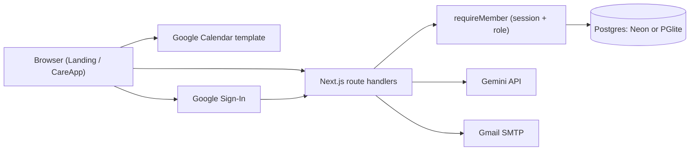

# Architecture

ApnaHaath is a Next.js 15 App Router app. The browser talks only to route handlers. Those handlers go through `requireMember()` (session + role in that circle), then read and write a Postgres database (Neon in production, in-process PGlite in tests).

- **Roles:** only the elder can mark a dose taken; a caretaker can only witness; family can propose medicine changes and add appointments.
- **AI:** Gemini writes safety notes, the doctor brief, and (when the circle's language is not English) elder-facing reminder text. Any output that suggests a dose change is discarded (`rejectsMutation` in `src/lib/gemini.ts`).
- **Reminders:** an idempotent outbox emails upcoming doses, missed doses and appointments. Upcoming-dose emails include the elder's one-tap link.
- **Calendar:** appointments expose an "Add to Google Calendar" link (`src/lib/calendar.ts`) — a public template URL, no API key.

See the [README](README.md) requirement table for the route, screen and test that backs each feature.
