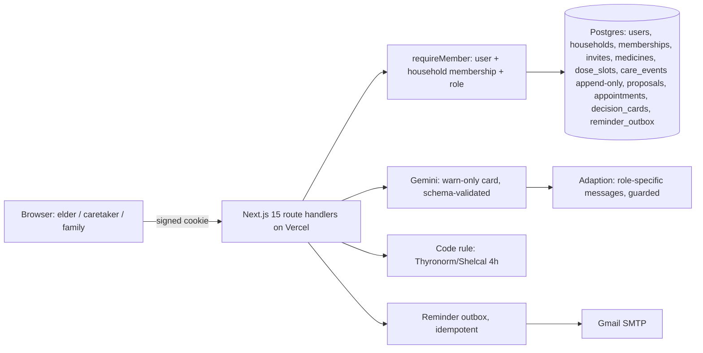

# ApnaHaath

**Dawai unke haath se. Log unke naam se.** — *Medicine from her hand. The log in her name.*

A shared medicine log for an elder, her caretaker and her family. Only the elder can mark a dose as taken. Family can suggest changes, but nothing changes until she says yes. AI can warn — it can never change a prescription.

⚠️ Not a doctor or a medical device. In an emergency **call 108** or go to the nearest hospital.

## Try it

Open the app and press **Try the demo household** — it creates a fresh, private copy of a fictional care circle (Kamla Devi Shukla, 74, Lucknow) with 3 days of history, a Brufen + Ecosprin safety note and a doctor appointment. Buttons at the top let you view as Kamla (elder), Sunita (caretaker) or Priya (family). Demo logins and PINs are shown only inside that demo.

Or create your own: **Sign up → Create a care circle → Invite elder / caretaker / family (one-time codes) → Suggest medicines → Elder accepts and confirms doses.**

## Requirement → code → screen

| Requirement | Code | Screen |
|---|---|---|
| Accounts (no hard-coded users) | `src/app/api/auth/*` — bcrypt passwords, HMAC-signed session cookie, 5-try login lockout (stored in DB) | Landing → Sign up / Sign in |
| Care circle + roles (elder, **caretaker**, **family**) | `src/app/api/households`, `src/lib/auth.ts` (`requireMember`) — role read from DB membership on every request | Onboarding → Create a care circle |
| Invites | `src/app/api/invites*` — single-use, 48 h expiry, only SHA-256 hash stored, role assigned server-side | Care circle → Invite … / Onboarding → Join |
| **Passcode/PIN** re-auth | Personal PIN per membership (bcrypt), asked before every change, 5-try lockout | PIN prompt on every action |
| Medication **schedule** | `src/app/api/proposals` — family suggests add / change time / stop; elder accepts or declines | Medicines |
| **Adherence** | `getAdherenceStats()` (`src/lib/db.ts`) — confirmed / witnessed / skipped (with reason) / missed counted separately; **Elder-confirmation rate** = confirmed ÷ (confirmed + missed) | Today, History |
| Witness ≠ taken | `src/app/api/doses/witness` never changes dose status; only the elder role may call `doses/confirm` | Today (caretaker: "I saw her take it") |
| **Appointments** | `src/app/api/appointments` (family add + edit) | Appointments |
| **Email reminders** | `src/lib/reminders.ts` (idempotency keys, skips never reported as missed, no drug names in subjects) + Gmail SMTP (`src/lib/email.ts`) | Safety → Email reminders |
| AI decision (Google **Gemini**) | `src/lib/gemini.ts` — `gemini-3.5-flash` (falls back to `gemini-flash-lite-latest`), strict warn-only JSON schema, any dose change rejected, offline fallback | Safety → safety notes, doctor brief |
| AI communication (**Adaption**) | `src/lib/adaption.ts` — Responses API rewrites a validated card into elder / caretaker / family messages; same no-dose-change guard; template fallback | Safety → Generate with Adaption |
| AI weekly care summary (**Adaption**) | `src/lib/weekly.ts`, `POST /api/summary/weekly` — 7-day numbers computed in code (confirmed / missed / skipped + reasons / witnessed / self-added, most-missed medicine); Adaption words them per role; validated, template fallback | History → Get weekly care summary |
| Fixed clinical rule | `src/lib/rules.ts` — Thyronorm and Shelcal ≥ 4 h apart (code, not AI) | Medicines |
| Isolation | Every query is scoped by `household_id` from the caller's membership | — |
| Accessibility | `lang="en"`, labelled inputs, large targets, read-aloud | All |
| Tests | `tests/app.test.ts` (18 tests, offline on PGlite) + CI `.github/workflows/ci.yml` | — |

## AI features

| Feature | Model | Guard rails |
|---|---|---|
| Safety notes (decision cards) | Google Gemini | Strict JSON schema, warn-only; any dose/prescription change is rejected; seeded offline card if the API fails; generated only on a button press |
| Care-circle messages | Adaption | Rewrites an already-validated card for elder / caretaker / family; same no-dose-change filter; template fallback |
| Weekly care summary | Adaption | Numbers computed in code, AI only phrases them; filter + template fallback; disclaimer on every output |
| Doctor brief | Template from the append-only log | No AI inference about doses |

## Architecture



## Run locally

```bash
npm ci
npm test            # 18 tests, offline (PGlite in-memory Postgres)
npm run dev         # http://127.0.0.1:3457 — without DATABASE_URL uses PGlite
```

## Deploy (Vercel)

1. Import the GitHub repo in Vercel (framework: Next.js). Keep Deployment Protection off for production so judges can open it.
2. Environment variables: `DATABASE_URL` (Postgres — Neon, or Supabase **pooler** URL on port 6543 for serverless), `SESSION_SECRET`, `RESET_ADMIN_CODE`, `GEMINI_API_KEY`, `GMAIL_USER`, `GMAIL_APP_PASSWORD`, `ADAPTION_API_KEY`.
3. Tables are created automatically on first request (`CREATE TABLE IF NOT EXISTS`). Nothing is auto-wiped.

Alternative: `Dockerfile` / `render.yaml` (Render, Docker).

## Why (cited)

Among older adults in six Indian cities, polypharmacy prevalence was **33.7%** and about **1 in 5 (19.7%)** self-medicated ([Scientific Reports, 2025](https://www.nature.com/articles/s41598-024-84627-2)).

## Honest limitations

- PIN/password auth is solid for a demo but not audited; no DPDP, HIPAA or CDSCO claims.
- Demo households use fictional data; demo emails stay in the in-app outbox.
- Timestamps are stored as IST ISO-8601 text.

MIT — hackathon project.
