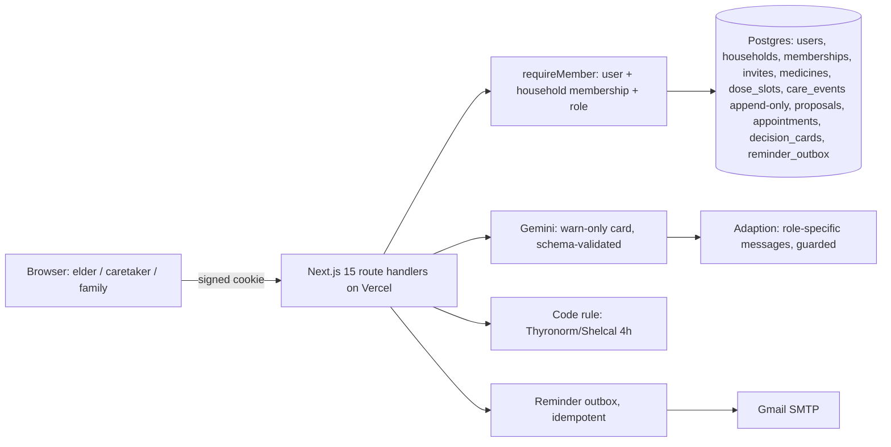

# ApnaHaath — the elder's own medicine log

[](.github/workflows/ci.yml)
[](#tests)
[](#)
[](LICENSE)
[](src/lib/gemini.ts)

**Live:** https://apnahaath-ramithas-projects-88e2a822.vercel.app (also https://apnahaath-care.vercel.app)

**Dawai unke haath se. Log unke naam se.** — *Medicine from her hand. The log in her name.*

⚠️ Not a doctor or a medical device. In an emergency **call 108** or go to the nearest hospital.

## Challenge and chosen vertical

**Vertical: Elderly Care.** The brief (requirements as given to us):

> Build a shared tool for an elder, her **caretaker** and her **family**, protected by a **passcode**, that manages **medication schedules**, tracks **adherence**, keeps **appointments**, and sends **email reminders** for upcoming doses, missed doses and appointments — going beyond a basic reminder app with a smart, context-aware assistant, while keeping the elder at the centre of decisions.

**Our answer:** a care log where *only the elder* can mark a dose as taken. The caretaker can only witness; family can only *propose* changes, which the elder accepts or declines with her PIN. Google **Gemini** reads the log and **warns** (e.g. self-reported Brufen while on Ecosprin) — any AI output that tries to start, stop or change a dose is thrown away in code.

### Why (cited)

Among older adults in six Indian cities, polypharmacy prevalence was **33.7%** and about **1 in 5 (19.7%)** self-medicated ([Scientific Reports, 2025](https://www.nature.com/articles/s41598-024-84627-2)).

## Try it (judges: 3 minutes)

There is no fake demo data — everything is a real account.

1. Open the live URL → **Start your care circle** → sign up with email (a 6-digit code arrives by email; 10-minute expiry) or **Continue with Google**.
2. Create a care circle: elder's name, city, **your role**, and a personal PIN.
3. **Care circle** → invite the elder and caretaker (one-time link: Copy / Share / WhatsApp). Open the link in another browser to sign up as them.
4. Family → **Medicines** → suggest a medicine; the elder accepts with her PIN (if you created the circle *as the elder*, your own additions apply at once).
5. Elder → **Today** → the big **Yes, I took it** button → PIN. Caretaker → **I saw her take it** → recorded as a witness only.
6. **Safety & AI** → Check the list with Gemini, Make doctor brief → Print; Run reminder check. **History** → 7 days + weekly AI summary → Copy / WhatsApp.
7. Sidebar (desktop) or footer (mobile) → **Larger text** / **High contrast**.

## Evaluation criteria mapping

| Criterion | What we did | Evidence |
|---|---|---|
| **Problem alignment** | Every requirement noun (passcode, caretaker, family, schedule, adherence, appointment, email reminder) maps to a route, a screen and a test (table below). Elder-centred: only she confirms; proposals need her PIN | [Requirement table](#requirement--code--screen--test), `src/app/api/doses/confirm/route.ts`, `src/app/api/proposals/route.ts` |
| **Code quality** | TypeScript strict, Next.js 15 route handlers, one `requireMember()` auth gate, zod on every body, small pure modules (`rules.ts`, `weekly.ts`, `cards.ts`, `doselink.ts`), ESLint clean, CI runs tests + build | `src/lib/*`, `.github/workflows/ci.yml`, `eslint.config.mjs` |
| **Security** | email OTP verification + Google sign-in, bcrypt passwords/PINs + lockouts, HMAC sessions, role from DB, household isolation, signed single-use email links, per-IP rate limits, CSP/HSTS headers, generic errors, AI dose-change filter | [SECURITY.md](SECURITY.md), tests *isolation and security*, *one-tap email links*, *rate limits* |
| **Efficiency** | Serverless Neon HTTP driver (no connection pool to exhaust), idempotent reminder outbox, AI only on a button press with 10–15 s timeouts + template fallbacks, today's slots created lazily, server-rendered first paint (CLS 0) | `src/lib/db.ts`, `src/lib/reminders.ts`, `src/lib/gemini.ts`, [Lighthouse](#efficiency) |
| **Testing** | 38 automated tests (Vitest, offline on in-process Postgres): roles, isolation, lockouts, invites, reminders, AI guards, rate limits, email links, accessibility | [Tests](#tests) |
| **Accessibility** | `lang`, labelled fields, ≥44 px targets (52 px buttons), 4.5:1 text contrast checked in a test, status in words not colour, PIN modal with `aria-modal`, live status region, read-aloud, larger-text + high-contrast toggles | `tests/a11y.test.tsx`, [Accessibility](#accessibility) |
| **Google services** | **Gemini** (`gemini-3.5-flash` → `gemini-flash-lite-latest` fallback) for safety notes and the doctor brief; **Google Sign-In**; Gmail SMTP for codes and reminders; optional **Cloud Run** path (`Dockerfile`, `cloudrun.yaml`) | `src/lib/gemini.ts`, `src/lib/email.ts`, [Deploy](#deploy) |

## Requirement → code → screen → test

| Requirement | Code | Screen | Test |
|---|---|---|---|
| Accounts (no hard-coded users) | `src/app/api/auth/*` — email sign-up with 6-digit OTP (`src/lib/otp.ts`: SHA-256 hashed, 10 min, 5 tries, 60 s resend cooldown), **Continue with Google** (`src/lib/google.ts`, OAuth 2.0 code flow, state cookie, fixed `APP_URL` callback), bcrypt, HMAC cookie, 5-try lockout | Landing → Sign up / Sign in | *login works…*, *login is locked…*, 3 tests in *email verification (OTP)* |
| Care circle + roles (elder, **caretaker**, **family**) | `src/app/api/households`, `requireMember` in `src/lib/auth.ts` | Onboarding | *caretaker cannot confirm a dose…*, *family cannot mark a dose taken* |
| Invites | `src/app/api/invites*` — single-use, 48 h, hash only | Care circle → Invite (Copy / Share / WhatsApp) | *an invite code cannot be reused*, *only the owner can create invites* |
| **Passcode/PIN** | per-membership PIN (bcrypt), asked in a modal before every change, lockout | PIN dialog | *elder PIN locks after 5 wrong tries* |
| Medication **schedule** | `src/app/api/proposals` — add / change time / stop, elder decides | Medicines | setup flow in `beforeAll`, *Thyronorm–Shelcal 4-hour gap…* |
| **Adherence** | `getAdherenceStats()` — confirmed / witnessed / skipped / missed separately | Today, History (7 days) | *caretaker cannot confirm…; witness does not mark it taken*, *skip is not counted as missed…* |
| **Appointments** | `src/app/api/appointments` | Appointments | *family can add and edit an appointment; caretaker cannot* |
| **Email reminders** (upcoming / missed / appointment) | `src/lib/reminders.ts`, `src/lib/email.ts` — idempotent, no drug names in subjects | Safety → Email reminders (status per entry) | *skip … never triggers a missed email; reminder runs are idempotent*, *upcoming-dose emails include the elder…* |
| One-tap "I took it" email link | `src/lib/doselink.ts`, `/api/doses/link` | Email → confirmation page | 3 tests in *one-tap email links* |
| Smart assistant (Gemini) | `src/lib/gemini.ts` — warn-only JSON, dose changes rejected | Safety notes, doctor brief | *Gemini card JSON with a dose change is rejected*, *rejectsMutation* tests |
| AI messages + weekly summary (Adaption) | `src/lib/adaption.ts`, `src/lib/weekly.ts` | Safety, History | *Adaption output with a dose change is rejected…*, *computes numbers in code…* |
| Isolation | every query scoped by `household_id` | — | *a member of another household cannot read or act on this one* |
| Accessibility | see below | All | `tests/a11y.test.tsx` (8 tests) |

## Google Services used

| Service | Use | Where |
|---|---|---|
| **Gemini API** | Safety notes (decision cards) from the medicine list + log; doctor brief wording. Strict JSON, warn-only, validated; offline fallback | `src/lib/gemini.ts`, `src/app/api/cards/generate`, `src/app/api/brief` |
| **Google Sign-In (OAuth 2.0)** | "Continue with Google" — plain authorization-code flow, verified Google email links to an existing account | `src/lib/google.ts`, `src/app/api/auth/google/*` |
| **Gmail (SMTP, app password)** | Sign-up verification codes and reminder emails | `src/lib/email.ts`, `src/lib/otp.ts` |
| **Cloud Run** (optional path) | `Dockerfile` (standalone Next.js, non-root, port 8080) + `cloudrun.yaml` (health probes). The live demo runs on Vercel | `Dockerfile`, `cloudrun.yaml` |

Other AI: **Adaption** Responses API phrases already-validated facts for each role (same dose-change guard).

## AI guard rails

| Feature | Model | Guard rails |
|---|---|---|
| Safety notes | Gemini | JSON schema, warn-only; `rejectsMutation()` drops any start/stop/change-dose text; deduped (newest kept, timestamped); seeded offline card |
| Doctor brief | Gemini (template fallback) | Facts from the append-only log; markdown stripped; mutation filter; emergency line + disclaimer appended in code |
| Care messages / weekly summary | Adaption | Numbers computed in code, AI only words them; same filter; template fallback |

## Architecture



## Efficiency

- Neon serverless HTTP driver: no TCP pool to exhaust on serverless; tables created once per instance (`CREATE TABLE IF NOT EXISTS`).
- AI calls only on a user's button press, with timeouts (Gemini 15 s, Adaption 10 s) and template fallbacks — the app never waits on AI to render.
- Reminder outbox uses idempotency keys, so repeated cron/button runs never double-send.
- The home page is server-rendered with the session check, so there is no loading flash.
- Lighthouse (production, 15 Nov 2026, Asia/Calcutta, [apnahaath-care.vercel.app](https://apnahaath-care.vercel.app)): desktop Performance 99 / Accessibility 100 / Best Practices 100 / SEO 100; mobile 99 / 100 / 100 / 100; CLS 0. Reports are in `audits/`. The longer `*.vercel.app` project URL is noindexed by Vercel (SEO 66) — use the `apnahaath-care` alias as the public URL.

## Security

Summary in the criteria table; full list in [SECURITY.md](SECURITY.md).

## Accessibility

Targets **WCAG 2.2 AA** (checked by automated tests plus manual keyboard/screen checks — not a formal audit, and we do not claim AAA):

- 3.1.1 `lang="en"`; 1.3.1 / 4.1.2 every field labelled, every button named; 2.5.8 targets ≥ 44 px (buttons 52 px, email page 56 px).
- 1.4.3 text colours ≥ 4.5:1 on page and card backgrounds (computed in a test); 1.4.1 dose status always in words, not colour alone.
- PIN dialog: `role="dialog"`, `aria-modal`, labelled input, Escape to close; toasts in a `role="status"` live region, auto-dismissed.
- Elder-friendly: large type, read-aloud for safety notes, **Larger text** and **High contrast** toggles (remembered per device).

## Deploy

**Vercel (live):** import the repo (framework Next.js), set env vars `DATABASE_URL` (Neon), `SESSION_SECRET`, `APP_URL` (fixed public URL used for the Google callback), `GOOGLE_CLIENT_ID`, `GOOGLE_CLIENT_SECRET`, `GEMINI_API_KEY`, `ADAPTION_API_KEY`, `GMAIL_USER`, `GMAIL_APP_PASSWORD`, optional `NEXT_PUBLIC_SITE_URL`. Keep Deployment Protection off for production.

**Google Cloud Run (optional):**

```bash
gcloud run deploy apnahaath --source . --region asia-south1 --allow-unauthenticated \
  --set-env-vars DATABASE_URL=...,SESSION_SECRET=...,GEMINI_API_KEY=...
# or: build the Dockerfile, push to Artifact Registry and apply cloudrun.yaml
```

Tables are created on first request. Nothing is auto-wiped.

## Run locally

```bash
npm ci
npm test            # 38 tests, offline (PGlite in-process Postgres)
npm run dev         # without DATABASE_URL uses PGlite
```

## Tests

`tests/app.test.ts` (27) and `tests/a11y.test.tsx` (8), run in CI on every push:

- **accounts, care circles, invites** — login works with the right password and rejects a wrong one
- **accounts, care circles, invites** — an invite code cannot be reused
- **accounts, care circles, invites** — only the owner can create invites
- **accounts, care circles, invites** — login is locked after 5 wrong passwords
- **role rules** — caretaker cannot confirm a dose (403); witness does not mark it taken
- **role rules** — family cannot mark a dose taken (403)
- **role rules** — elder PIN locks after 5 wrong tries
- **role rules** — family can add and edit an appointment; caretaker cannot
- **isolation and security** — a member of another household cannot read or act on this one
- **isolation and security** — forged / unsigned session cookie is rejected
- **reminders and skips** — skip is not counted as missed and never triggers a missed email; reminder runs are idempotent
- **AI guards** — Gemini card JSON with a dose change is rejected
- **AI guards** — Adaption output with a dose change is rejected and falls back to templates
- **AI guards** — Thyronorm–Shelcal 4-hour gap is enforced in code
- **weekly care summary (Adaption)** — computes numbers in code, rejects a dose-change summary and falls back to the template
- **weekly care summary (Adaption)** — weekly summary route requires sign-in
- **no-dose-change guard (rejectsMutation)** — rejects instructions that would change, stop or replace a medicine
- **no-dose-change guard (rejectsMutation)** — allows ordinary warn-only safety advice
- **rate limits** — per-IP sign-up limiter blocks one client but not another
- **safety-note dedupe** — keeps only the newest note about the same medicines
- **one-tap email links (signed, expiring, single use)** — rejects tampered, expired and other-household links
- **one-tap email links (signed, expiring, single use)** — a family member's link is only a witness and never marks the dose taken; a role cannot be claimed
- **one-tap email links (signed, expiring, single use)** — GET never changes anything; the elder's own link confirms once and cannot be reused
- **reminder recipients** — upcoming-dose emails include the elder; personal links never go into the shared outbox
- **email verification (OTP)** — sign-up gives no session until the 6-digit code is verified; wrong codes are limited to 5
- **email verification (OTP)** — codes are stored hashed, expire after 10 minutes, and resend has a cooldown
- **email verification (OTP)** — Google sign-in is disabled gracefully without credentials and uses the fixed callback URL
- **accessibility** — the document declares its language (WCAG 3.1.1)
- **accessibility** — every form field on the landing page has a label (WCAG 1.3.1 / 4.1.2)
- **accessibility** — every button has an accessible name (WCAG 4.1.2)
- **accessibility** — buttons and inputs are at least 44px tall (WCAG 2.5.8, enhanced 2.5.5 size)
- **accessibility** — text colours meet 4.5:1 contrast on the page and card backgrounds (WCAG 1.4.3)
- **accessibility** — dose status is always written in words, not colour alone (WCAG 1.4.1)
- **accessibility** — the PIN dialog is a labelled modal and messages use a live status region
- **accessibility** — the one-tap email page is usable: lang, large 56px button, visible focus

## Assumptions

- One elder per care circle; times are IST; doses are scheduled daily at fixed times.
- The elder can use a phone (or someone hands it to her) and has her own PIN; a caretaker's tap is never counted as "taken".
- The app is a log and a safety net, not a prescriber: it never changes a medicine; family proposals need the elder's acceptance.
- Google sign-in needs the callback `APP_URL/api/auth/google/callback` registered in Google Cloud Console.

## Honest limitations

- Not audited; no DPDP, HIPAA or CDSCO claims.
- Rate limits are in-memory per serverless instance.
- Email delivery depends on the configured Gmail app password.

## License

[MIT](LICENSE)
